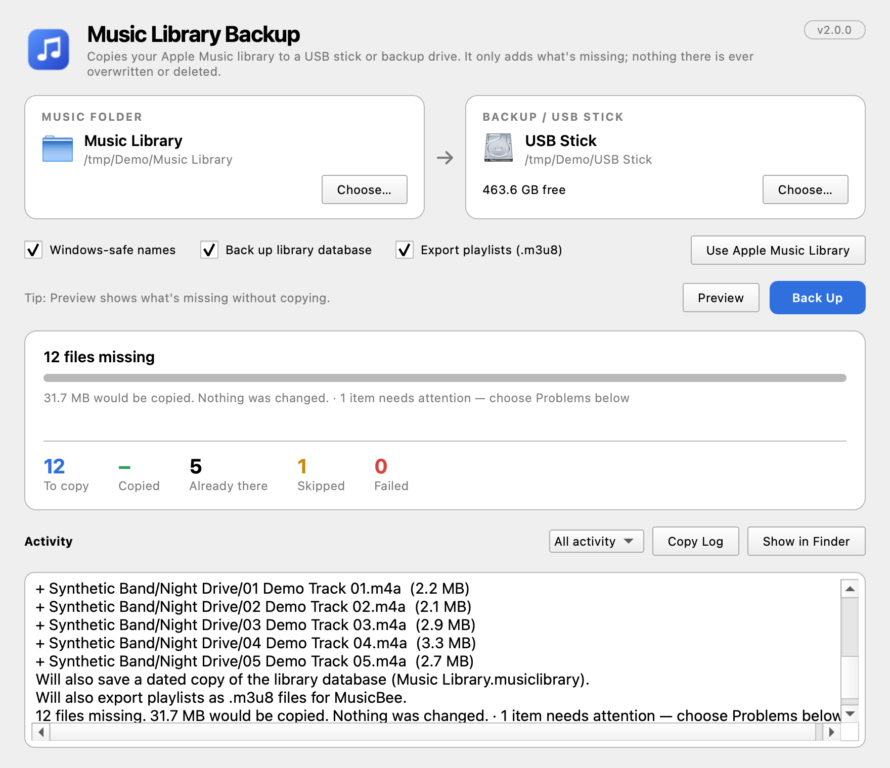
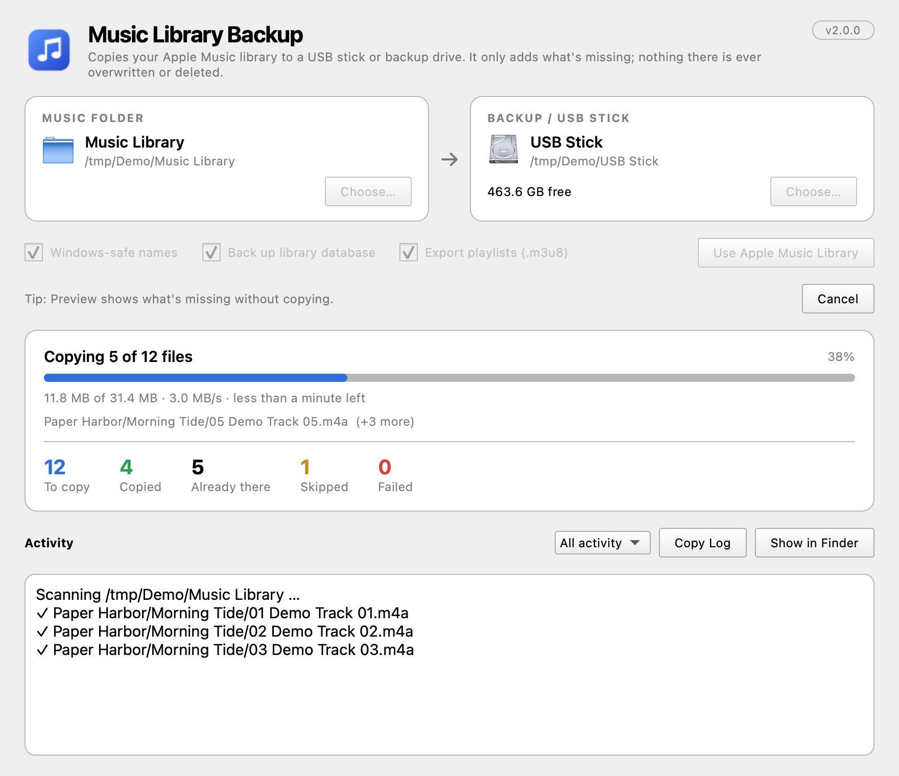
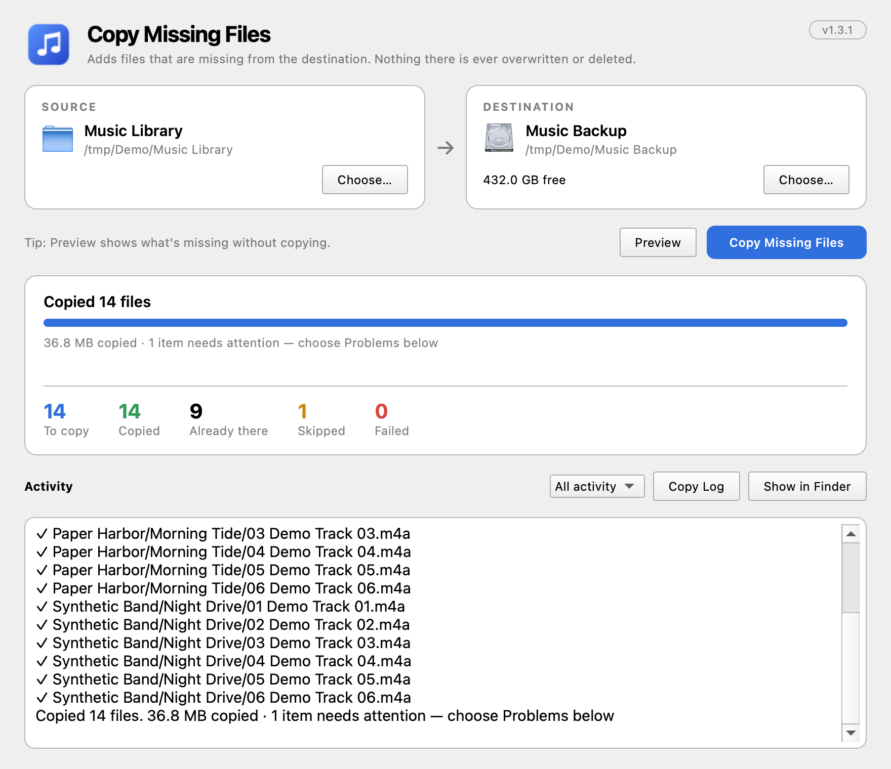
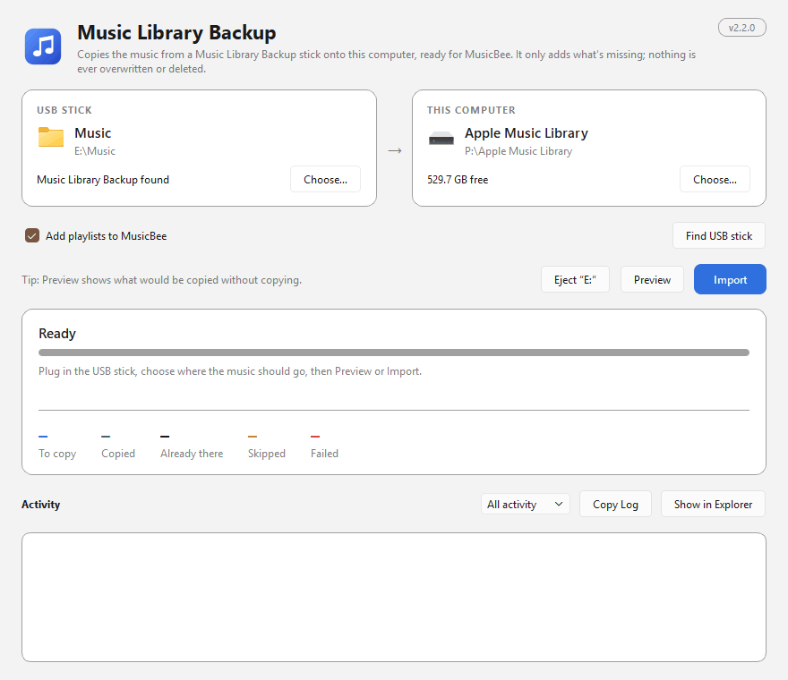
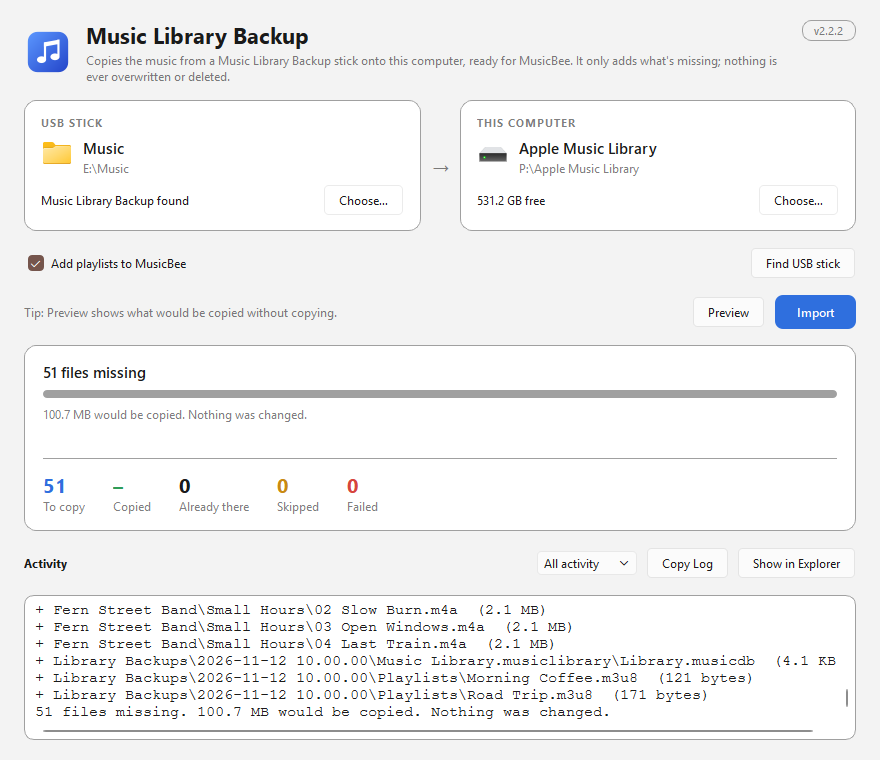
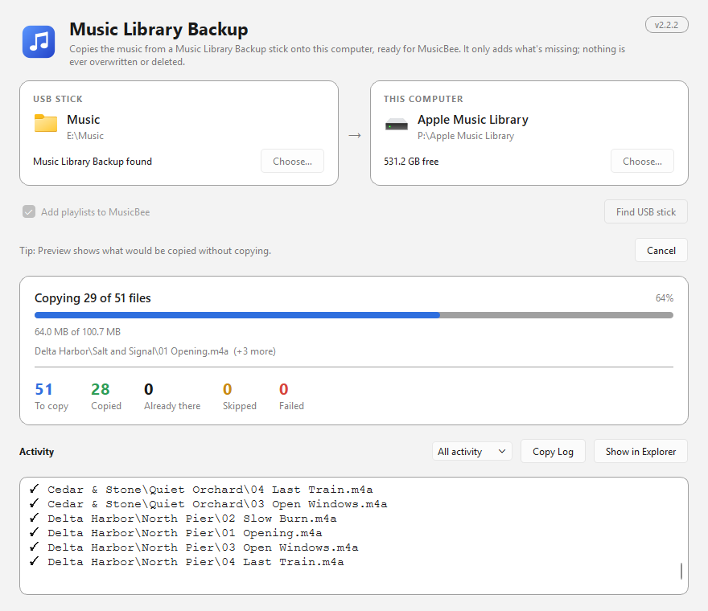
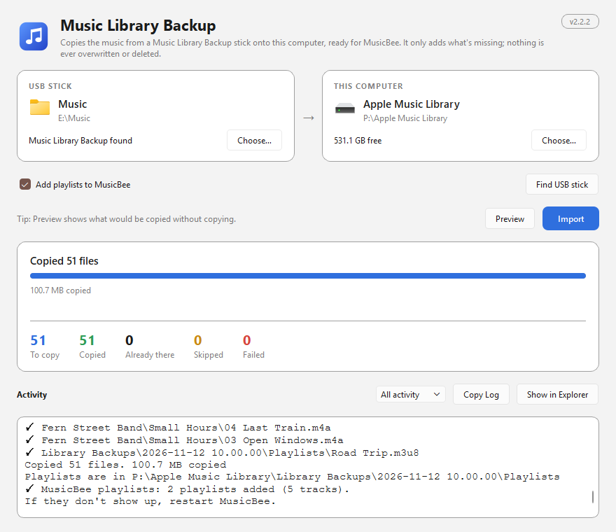

# Music Library Backup

Back up your Apple Music library to a USB stick or external drive, ready to use
on a Windows PC with MusicBee or any other player, without ever overwriting or
deleting what's already there.

Music Library Backup compares your music folder with a backup folder, shows you
exactly what's missing, and copies only those files. It can also save a dated copy
of the library database and export your playlists as `.m3u8` files. It's built
with Python and PySide6. The backup runs on your Mac; on the Windows PC the same
app imports the stick into your music folder and adds the playlists to MusicBee.

> Formerly **Copy Missing Files**. Your saved folders carry over automatically.

## Highlights

- Adds only what's missing. Files already in the destination are never
  overwritten, modified, or deleted.
- **Use Apple Music Library** fills in Apple Music's media folder for you.
- **Windows-safe names** (on by default): characters Windows and exFAT reject,
  such as `? : * " < > |`, become `_`; trailing dots and spaces and reserved names
  like `CON` are fixed; names are stored in the Unicode form Windows expects; links
  are copied as real files; and paths too long for older Windows apps are flagged.
- Leaves out Mac-only clutter (`.DS_Store`, `._*` files) so the stick stays clean
  on Windows.
- **Back up library database**: saves a copy of `Music Library.musiclibrary`
  (ratings, play counts, playlists) in a new dated folder under
  `Library Backups/` each run. Earlier copies are kept.
- **Export playlists (.m3u8)**: saves every Apple Music playlist with paths
  relative to the playlist file, so MusicBee can import them whatever drive letter
  the stick gets.
- **Preview** lists every missing file, its new Windows-safe name if it changes,
  and the total size before anything is copied.
- Live progress shows megabytes copied, speed, time left, and the files being
  copied. Up to four files are copied at once.
- Crash-safe copies: each file is written under a temporary name and renamed into
  place only when complete.
- Detects an unplugged drive, both before starting and mid-copy, checks free
  space first, and stops cleanly if the drive fills up.
- **Import to this computer** (the Windows side): copies the music from the stick onto
  the PC, adding only what's missing. It finds the stick for you, and
  **Add playlists to MusicBee** puts the playlists into MusicBee with full paths.
- **Eject** the stick from the app on the Mac when the backup is done. (On Windows,
  use the taskbar's "Safely Remove Hardware" icon after an import.)
- Warns before copying your library a second time when the music folder and the
  destination are one folder level apart, and offers to switch to the matching folder.
- **Cancel** stops right away, even in the middle of a large file, and removes the
  partial copy.
- Filterable activity log (All, Copied, To copy, Problems), with **Copy Log** and
  **Show in Finder**.

## Screenshots

The screenshots below show the Mac backup, and the Windows import has its own
under [Importing on Windows](#importing-on-windows). All were captured from a
disposable demo library containing fictional artist names, album names, and
filenames. They contain no personal files or real library paths.







## Moving your library to Windows with MusicBee

1. Plug in the USB stick. **exFAT** is the best format: both macOS and Windows can
   read and write it, and it has no 4 GB file limit (FAT32 does, and macOS can't
   write to NTFS). To format it, use Disk Utility → Erase → ExFAT.
2. Click **Use Apple Music Library** (or choose your music folder), then choose a
   folder on the stick, such as `Music`, as the destination.
3. Leave **Windows-safe names**, **Back up library database** and **Export
   playlists** on, click **Preview** to check, then **Back Up**.
4. The first time, macOS asks whether the app may control Music. Allow it so the
   playlists can be read. You can change this later in System Settings → Privacy &
   Security → Automation.
5. Click **Eject** and unplug the stick.
6. On the Windows PC, follow [Importing on Windows](#importing-on-windows) below.
   You can also do it by hand: in MusicBee, **File → Scan Folders for New Files**,
   choose the `Music` folder on the stick (or copy it to the PC first), then drag
   the `.m3u8` files from `Library Backups\<latest date>\Playlists` onto MusicBee's
   Playlists panel.

What doesn't carry over:

- Apple Music subscription downloads and old `.m4p` purchases are copy-protected
  and won't play outside Apple Music. Playlist export leaves out tracks that aren't
  plain files in your music folder and says how many.
- Cloud-only tracks that aren't downloaded aren't on your Mac, so they can't be
  copied. Download them in Apple Music first.
- Ratings and play counts live in the library database. MusicBee can't read
  Apple's database; the backup copy is for restoring Apple Music on a Mac.

## Importing on Windows

On Windows the app opens in **Import to this computer** mode. (On a Mac, switch to it
with the menu at the top right.)



1. Plug in the stick. The app looks for a drive that holds a Music Library Backup and
   fills in the source. Use **Find USB stick** to look again, or **Choose…** to pick
   the stick's Music folder yourself. If the stick comes back under another drive
   letter, the app finds it again.
2. Choose where the music should go on the PC. The default is
   `Music\Apple Music Library`.
3. Click **Preview** to see what would be copied, then **Import**. Only files that
   are missing are copied; nothing is overwritten or deleted. `Library Backups`
   (the database copy and playlists) comes along as it is.
4. **Add playlists to MusicBee** (on by default) then copies the newest backup's
   playlists into `Music\MusicBee\Playlists`, with full paths, because the relative
   paths in the backup stop working once a file is moved.
5. Remove the stick safely with the "Safely Remove Hardware" icon in the Windows
   taskbar (the app has no Eject button on Windows), then unplug it.

How playlists are kept up to date: a playlist the app wrote earlier is updated on
the next import, so edits made on the Mac come through, but only while it is
unchanged in MusicBee. A playlist you have edited there, or made yourself, is never
touched, and the log says so. Tracks that aren't on the PC are left out. To get the
Mac version of one you edited, delete it in MusicBee and import again. Nothing is
ever deleted, so a renamed playlist arrives as a new one. If new playlists don't
show up, restart MusicBee.

To make MusicBee pick up the music itself, add the import folder under **Preferences
→ Library** as a monitored folder. MusicBee has no command to scan from outside, so
the app can't start a scan for you.

Ratings and play counts don't carry over: MusicBee can't read Apple's database.

These screenshots show the Windows import window, captured from the same kind of
disposable demo library (fictional names, a stick on `E:` and a PC folder on `P:`).







## Restoring Apple Music from a backup

Quit Music, copy the media folder back, then copy a dated
`Music Library.musiclibrary` from `Library Backups` into `~/Music/Music`. Hold
Option while opening Music and choose it with **Choose Library…**.

## How it works

1. The app walks the music folder and, for every file, works out its name on the
   destination (the Windows-safe name if that option is on) and checks whether it's
   already there. A copy made under the original name also counts.
2. Anything missing is added to a plan. Files that already exist are counted as
   **Already there**. If the sizes differ, they're listed under **Problems** and
   left as they are. Two files that would get the same Windows name are flagged and
   only the first is copied.
3. **Preview** stops here and shows the plan. **Back Up** checks that the
   destination has enough free space, then copies each planned file through a
   temporary file that is renamed into place when complete.
4. Finally it creates `Library Backups/<date time>/` with the database copy and the
   playlists. It's a new folder every run, so nothing earlier is replaced.

Matching is by path only, so a file that changed in the source isn't recopied if a
file with the same name is already in the destination (unless the sizes differ, in
which case it's reported). Empty folders aren't copied.

## Requirements

- macOS 11 or later for the backup, Windows 10 or 11 for the import
- Python 3.10 or newer
- [PySide6](https://doc.qt.io/qtforpython-6/), the only dependency

## Installation

### 1. Clone the repository

```bash
git clone https://github.com/bardakanian/music-library-backup.git
cd music-library-backup
```

### 2. Create a virtual environment and install PySide6

```bash
python3 -m venv .venv
.venv/bin/python -m pip install --upgrade pip
.venv/bin/python -m pip install PySide6
```

Alternatively, double-click **Music Library Backup.command** in Finder. On first
run it creates `.venv`, installs PySide6, and starts the app. If macOS blocks it,
right-click the file and choose **Open**.

On Windows, double-click **Music Library Backup.bat** instead. On first run it creates
`.venv`, installs PySide6, and starts the app. Then run
`.venv\Scripts\python.exe make_launcher_windows.py` to put a **Music Library Backup**
shortcut on your desktop. It starts the project's latest code, so run the script again
if you move the folder.

### 3. Launch the app

```bash
.venv/bin/python app_qt.py
```

### 4. Optional: add it to Applications

```bash
.venv/bin/python make_launcher.py
```

This builds `Music Library Backup.app`, with its icon and version, and installs it
in `/Applications`, or in `~/Applications` if `/Applications` isn't writable. Use
`--no-install` to build it only into `build/`. If you had the old
`Copy Missing Files.app`, you can delete it.

The app runs `app_qt.py` from this project with the project's `.venv`, so it always
starts your latest code. Run the script again if you move the project folder.

## Privacy and local data

Music Library Backup works entirely offline. It has no account sign-in, telemetry,
analytics, advertising, or network access of any kind. To export playlists it asks
the Music app on your Mac for them, which macOS lets you allow or deny.

The only data it stores is the last-used folders and options, in:

```text
~/Library/Application Support/Music Library Backup/settings.json   (macOS)
%APPDATA%\Music Library Backup\settings.json                       (Windows)
```

This file contains absolute paths on your computer. Don't publish or commit it. On
Windows the same folder also holds `musicbee_playlists.json`, a list of fingerprints
of the playlist files the app has written into MusicBee, used to tell your edits from
its own.

The app only reads from the music folder and the library database. In the
destination it only creates new folders and files, plus a short-lived temporary
file (`.cmf-partial-<name>.part`, hidden on Windows) for the item being copied. On
Windows it also writes playlist files into MusicBee's Playlists folder, and only
ever replaces ones it wrote itself and you haven't changed.

## Project structure

```text
app_qt.py                      PySide6 app: window, options, progress, worker thread
copy_core.py                   Logic with no GUI: planning, Windows-safe names, copying,
                               library backup and playlist export
main.py                        Original Tkinter version (file copy only)
make_launcher.py               Builds and installs Music Library Backup.app
make_launcher_windows.py       Creates the Windows desktop shortcut
Music Library Backup.command   Double-click launcher (macOS) that also sets up .venv
Music Library Backup.bat       Double-click launcher (Windows) that also sets up .venv
CHANGELOG.md                   Version history (the version itself is VERSION in app_qt.py)
tests/                         Copy logic, music backup, worker, version and launcher tests
assets/screenshots/            Sanitized documentation screenshots
```

## Development

Run the tests from the project root:

```bash
QT_QPA_PLATFORM=offscreen .venv/bin/python -m unittest -v
```

Check that the modules compile:

```bash
.venv/bin/python -m compileall -q app_qt.py main.py copy_core.py make_launcher.py
```

Each change bumps `VERSION` in `app_qt.py` and adds an entry to `CHANGELOG.md`. A
test checks that they match.

## Troubleshooting

- **"Drive not connected":** the music folder or the stick is on a drive that
  isn't mounted. Connect it, then switch back to the window to refresh.
- **"Not allowed to read Apple Music playlists":** allow the app (or Terminal, if
  you started it from there) under System Settings → Privacy & Security →
  Automation → Music.
- **"Back up library database (not found)":** the app looks for a
  `.musiclibrary` next to your music folder and in `~/Music/Music`. Choose the media
  folder inside your library folder.
- **A file is listed under Problems as "a different version is already there":**
  the destination has a file with the same name but a different size. The app never
  overwrites it. Compare the two and replace it yourself if needed.
- **A path is flagged as too long:** MusicBee usually copes, but some Windows
  tools stop at 260 characters. Use a short destination folder name, such as `E:\Music`.
- **"Not enough space":** free up space on the stick or choose a bigger one.
  Nothing is copied when there isn't room for everything.
- **The stick has `._` files from older versions:** the app now removes the ones
  it creates, but copies made before 2.0.1 left one beside every file. Run
  `dot_clean -m /Volumes/<stick name>` in Terminal to remove them.
- **Eject fails (Mac):** close any Finder window or app that's using the stick, then
  try again.
- **Windows: "Folder not found. Is the USB stick plugged in?":** plug the stick in
  and switch back to the app, or click **Find USB stick**.
- **Windows: playlists are missing in MusicBee:** the app only adds them if
  `Music\MusicBee\Playlists` exists, so open MusicBee once first. Then restart
  MusicBee after an import.
- **Windows: a copy fails on a very long path:** turn on long path support in Windows,
  or import to a shorter folder such as `D:\Music`.
- **Windows: the stick isn't found automatically:** the app looks for a `Library Backups`
  folder. **Find USB stick** also accepts a drive with a plain `Music` folder.

## Project status

The app is a personal tool under active development. Keep a backup of anything
important before copying large libraries.

## Development approach

Developed with AI-assisted tools under human direction, review, testing, and refinement.

## License

This project is available under the [MIT License](LICENSE).
